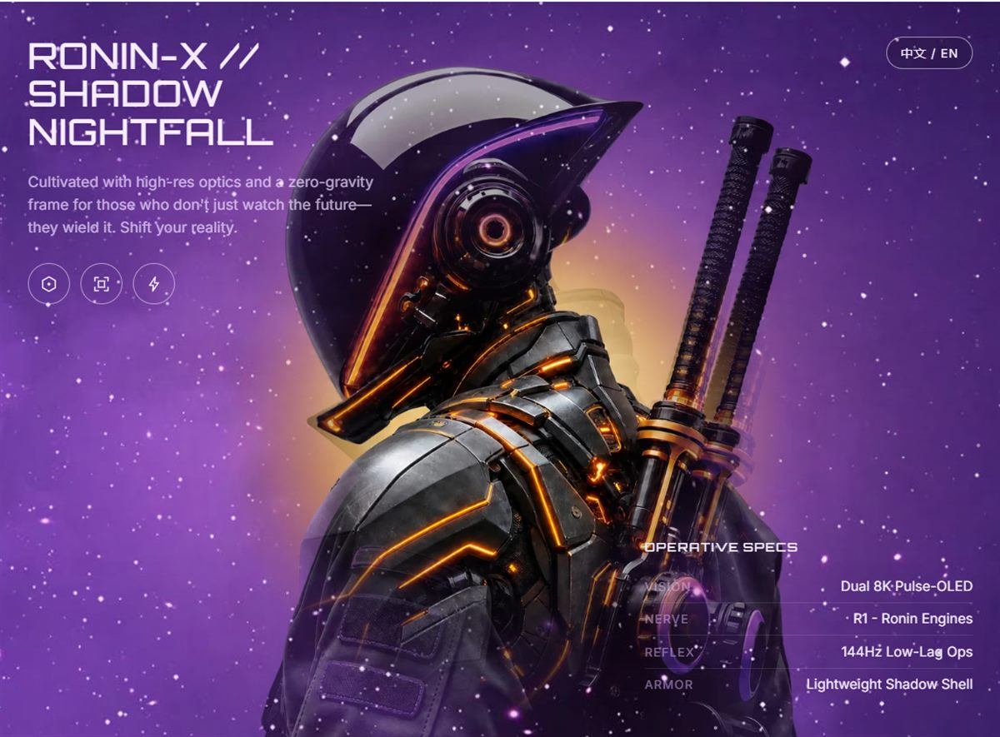

  

# WebDesign6-RoninX

Cyber Ronin // Neural Edges 是一个单文件、全视口的赛博浪人主题 Hero 页面。页面融合紫色星云背景、动态星星粒子、中文 / English 切换，以及鼠标聚光揭示备用场景的交互。

## 设计亮点

1. **星云粒子场**  
   使用 Canvas 绘制缓慢漂移与闪烁的星点，让静态背景拥有持续的空间感与层次。

2. **聚光揭示交互**  
   鼠标移动时，径向渐变会揭示另一张人物场景图，形成“基础场景 → 备用场景”的视觉切换。

3. **双语界面**  
   右上角的 `中文 / EN` 按钮可以切换标题、介绍和作战规格，适配中英文浏览。

## 使用方式

直接打开 [index.html](./index.html) 即可运行，无需构建工具或框架。

## 技术

- HTML / CSS / Vanilla JavaScript
- Canvas 粒子动画
- CSS Mask Spotlight Reveal
- Orbitron + Inter 字体
- 响应式布局与 `prefers-reduced-motion` 支持
